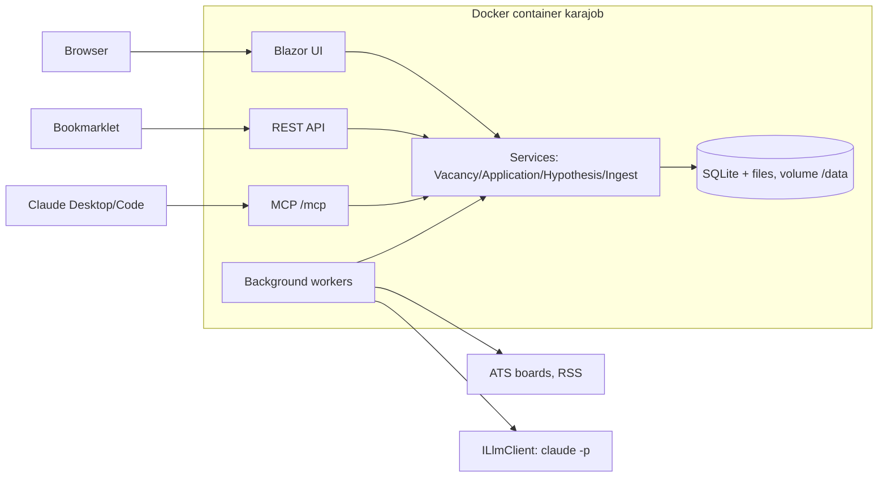

# Karajob — concept and design document

Nov 12, 2026 · @Maksim

## 1. Goal and principles

Karajob is a family (multi-profile) web application in Docker that turns a job search into a managed experiment: hypotheses → vacancies → applications → metrics → a decision on the hypothesis. It is a direct implementation of the career strategy template: items 2 (hypotheses), 3 (channels and tracking), 4 (evaluation criteria) and 5 (decisions) become entities and screens.

**Principles**

- **Data in service of decisions.** Every field must feed a metric or a decision on a hypothesis. If a field affects nothing, it is not in the MVP.
- **Several profiles, one container.** No passwords or roles, no microservices, no queues. Complexity only where AI requires it.
- **AI is an optional layer.** Everything can be done by hand; AI only speeds up data entry and search. The application must not break if the subscription limits run out.
- **The application is the source of truth, AI is a client.** AI works through the same API/MCP as the UI and stores no state.

### What I changed in the original requirements and why

| Original requirement | Problem | Solution in the concept |
| --- | --- | --- |
| Kanban: Targeted, Preparing, Applied, Done | There is no interview stage, so "conversion to the next positive step" cannot be calculated. "Done" mixes offer, rejection and silence. | Inbox is a separate section in the side menu (incoming, not yet triaged); the board is Targeted → Preparing → Applied → Interviewing → Closed; Closed requires an outcome (Offer / Rejected / Ghosted / Withdrawn). |
| A vacancy has a list of hypotheses | Conversion per hypothesis needs unambiguous attribution. If an application belongs to two hypotheses, the metric gets smeared. | A vacancy may *match* several hypotheses, but an *application* is tied to exactly one hypothesis and one CV (a version snapshot). |
| Criterion "≥10 relevant vacancies per week" | If you count only cards on the board, the metric depends on your laziness, not on the market. | *Found* vacancies are counted separately (Inbox, including dismissed ones: the Dismissed stage), not only those you applied to. |
| Decision "continue at 3–5% conversion" | With 20 applications one interview = 5%, zero = 0%. That is noise, not signal. | A minimum sample before a decision (30 applications or 3 weeks by default) and a confidence interval shown. |
| AI browses vacancy sites | Scraping LinkedIn/Indeed violates their ToS, breaks on anti-bot measures, and having an LLM read HTML is expensive. | The main source is the public ATS APIs (Greenhouse, Lever, Ashby, etc.) of companies in the directory, plus RSS/aggregator APIs. AI only evaluates fit; it does not scrape. |
| CV directory | Needed, but without versions you cannot say which CV text actually went to the employer. | A CV is a document with versions; an application references a specific version. |

## 2. Domain model

The center of the model is the **application (Application)**, not the vacancy: it is what links the vacancy, the hypothesis and the CV version and provides the data for conversion. In practice a board card = a vacancy + its single application (1:0..1), so for the UI it is one entity, and in the DB it is two. In code the application is called `JobApplication`: the name `Application` conflicts with the `Karajob.Application` project.

| Entity | Key fields | Relations |
| --- | --- | --- |
| **SearchGoal** (singleton) | role, industries, format (relocation/remote/hybrid), desired gross income + currency, countries, must-have conditions, search deadline, weekly goals (applications / contacts / adaptations) | — |
| **Hypothesis** | name, role, locations, industries, format, search keywords / stop words, positioning, strong skills, cover letter template, LinkedIn note, status (Draft / Active / Expanded / Paused / Disabled), test start date | N:1 CvDocument (primary CV), N:M JobSource, 1:N HypothesisCheckIn, 1:N HypothesisDecision |
| **CvDocument** (CV) | name, language, tags | 1:N CvVersion; one CV is used in many hypotheses |
| **CvVersion** | Markdown source, generated PDF (or an uploaded file + extracted text), parent version, vacancy (for adapted ones), change comment, date | N:1 CvDocument |
| **Company** | name, **slug ID (ubisoft), domains and aliases (unique, used for matching)**, website, description, icon, country/offices, size, ATS type + board token; personal notes and the "blacklist" live in a separate UserCompanyNote table, one per user | 1:N Project, 1:N Vacancy |
| **Project** (company project) | name, genre/type, engine, status (announced / in development / released), link | N:1 Company |
| **Vacancy** | role, link (normalized, for deduplication), location, format, salary range, raw description text, requirements (list), source (manual / ai-link / ai-scan), publication date, discovery date, stage (Inbox, board columns or Dismissed), dismissal reason | N:1 Company, N:M Hypothesis via **VacancyMatch** (score 0–100, rationale, who set it: human/AI), 0..1 JobApplication |
| **JobApplication** | application date, channel (site / referral / recruiter / cold email), cover letter (text), outcome (Offer / Rejected / Ghosted / Withdrawn) | N:1 Vacancy, **N:1 Hypothesis (exactly one)**, **N:1 CvVersion** |
| **ApplicationEvent** | type (StageChanged, Screening, TechInterview, TestTask, Rejected, Offer…), date, note; for meetings: start/end time, time zone, call link, Google Calendar event ID | N:1 Vacancy: stage transitions are recorded before the application too (Inbox → Targeted → Preparing). The source for all metrics and the card timeline. |
| **HypothesisCheckIn** | week, motivation 1–5, confidence 1–5, note | N:1 Hypothesis |
| **HypothesisDecision** | date, decision (Continue / Expand / Disable), reason, snapshot of metrics at the time of the decision, what was changed (for Expand) | N:1 Hypothesis |
| **JobSource** | name, type (AtsBoard / Rss / Api / ManualOnly), URL/parameters, polling frequency, enabled, last scan | N:M Hypothesis |
| **AiJob** | type (ParseLink / ScanSource / Score), input, status, result/error, tokens spent | A log of background AI work |

The table describes the target model. Phase 0 implements a subset of the fields; the rest (vacancy requirements, company ATS type, CV Markdown source, hypothesis keywords, etc.) are added together with the features that need them.

**Value conventions.** The salary range is always stored per month (gross, integers in the minor units of the currency); annual amounts are converted on input. The vacancy URL is stored in a single normalized field (lowercase, https, no tracking parameters): it is both the deduplication key and the link used to open the vacancy; the risk that a case-sensitive link will not open is accepted.

### Users and the master profile

The system is for a family: several users, no passwords or roles. `UserId` is introduced from the first migration even if you are the only user for now: today it is one field, while adding it later means rewriting every query.

| Entity | Key fields | Relations |
| --- | --- | --- |
| **User** (profile) | name, avatar/color, UI language, token for REST/MCP, own Claude token for background jobs (optional), answer bank for forms | 1:1 MasterProfile, 1:1 SearchGoal, 1:N hypotheses, CVs, vacancies, applications |
| **MasterProfile** | A single Markdown document with fixed sections: contacts, experience (all jobs and responsibilities), projects, achievements with numbers, skills, education, languages, interview stories (STAR). Version history. | 1:1 User. The source of truth for generating and adapting CVs, cover letters and interview preparation |

The master profile is everything that is true about the person, with no length limit. A CV is a selection from it for a hypothesis, 1–2 pages long. The fabrication check compares the CV against it. First fill: upload your current CVs and a LinkedIn export, AI assembles a draft, and you complete it from there.

**What is personal and what is shared.** Personal (EF Core filter by the current `UserId`): search goal, master profile, hypotheses, CVs, vacancies and applications, check-ins, decisions, metrics, and also personal notes and the "blacklist" for companies. Shared across the family: the directories of companies, projects and sources, since there is no point in creating Ubisoft twice. The scanner walks a source once and filters and scores by each user's hypotheses.

**Sign-in.** A profile picker screen (like Netflix) → cookie; the switcher is in the header. REST and MCP identify the user by a personal token (`/mcp?u=<token>` or a header); otherwise the bookmarklet and Claude do not know whose Inbox this is. The token here is not protection but an address. Without passwords the application is acceptable only on a home network (including via WireGuard on the router), never publicly.

**Deduplication.** A company has a human-readable ID (slug: ubisoft, blizzard), but AI matches it by the website domain and aliases, not by name: "Ubisoft", "Ubisoft Entertainment" and "Ubisoft Belgrade" would otherwise become three records. You set the slug (or AI suggests it), and the domain guards against AI creating "ubisoft-entertainment" next to an existing "ubisoft". For subsidiary studios there is an optional ParentCompany field. A vacancy is deduplicated by its normalized URL (without utm and tracking) and, as a soft warning, by the pair "company + role + 30 days".

**Out of MVP:** contacts and networking (recruiters, referrals). The strategy template requires a networking plan, and referrals convert better than cold applications, so the **Contact** entity (name, company, LinkedIn, contact status) is the first thing worth adding in v2. The application channel is already in the MVP, so that referral and site conversion can be compared.

## 3. Kanban, lifecycle and the apply window

Inbox is not a board column but a separate section in the side menu (like a backlog): a list of untriaged cards. The board has five columns, Targeted → Closed. Every move, including leaving Inbox, writes an ApplicationEvent, so metrics are computed from history, not from the current state.

| Stage | Meaning | Entry | Exit |
| --- | --- | --- | --- |
| **Inbox** (menu section) | Found but not triaged. Everything from AI lands here. | AI scan, link, manual entry | Buttons on the card: "→ To board" (to Targeted, immediately marking the matching hypotheses) or "Dismiss" with a reason (wrong role / location / stack / salary) → Dismissed stage |
| **Targeted** | I want to apply. At least one hypothesis is selected. | From Inbox or Preparing; reopened from Dismissed | To Preparing, to Applied via the apply window, to Dismissed |
| **Preparing** | Adapting the CV, writing a cover letter, looking for a referral. | From Targeted; reopened from Dismissed | To Applied via the apply window, back to Targeted, to Dismissed |
| **Applied** | The application is sent. The hypothesis (from those marked on the vacancy), CV version, channel and date are recorded. | From Targeted or Preparing; reopened from Closed | Interviewing or Closed. After N days (21 by default) without a reply, a "Ghosted?" hint |
| **Interviewing** | Any positive next step: screening, test task, interview. Inside is a timeline of steps. | From Applied; reopened from Closed | Closed |
| **Closed** | Closed with a mandatory application outcome: Offer / Rejected / Ghosted / Withdrawn. Hidden by default, with counters in the header. | From Applied or Interviewing (only an application has an outcome) | Reopen to Applied or Interviewing: the outcome is reset |
| **Dismissed** (not on the board) | Dismissed with a reason, either while triaging Inbox or after changing your mind before applying. Not an application, so it does not go into Closed or into conversion, but it counts in the "Market" metric. | From Inbox, Targeted or Preparing | Reopen to Inbox, Targeted or Preparing: the reason is reset |

Board filters: hypothesis, company, source. The golden rule: without a selected hypothesis a card cannot be moved to Applied, otherwise the application drops out of analytics. An invalid transition is a domain error and the state does not change; the table of allowed transitions is `VacancyStageRules`.

### Quick Add to Inbox

A vacancy can be added in 1–2 clicks from any device. The input is only a URL (plus an optional note); the card is created immediately with a "processing" status, while parsing and company matching run in the background. If AI is unavailable, the card simply waits in Inbox with its link, so nothing is lost.

| Where you are | How to add |
| --- | --- |
| In the app, any screen | The "+ Vacancy" button in the header (a floating button on a phone) → URL field, paste from the clipboard → Enter |
| Android phone | The app is installed as a PWA and appears in the Share menu (Web Share Target): from the browser or the LinkedIn app, "Share → Karajob" |
| iPhone | A PWA on iOS has no Share menu entry, so use a Shortcut that sends the URL to the REST `POST /api/inbox` |
| Desktop browser | The "To tracker" bookmarklet (see section 5): one click, and it also grabs the text of closed pages |
| Chat with Claude | "add \<url>" → MCP `ingest_vacancy` |

Prerequisite: access to the app from a phone outside the home network, through the WireGuard already set up on the router (see "Access" in section 6), and responsive layout for at least Inbox and Quick Add. A pitfall: a PWA (installing on the phone and the Share menu entry) works only over HTTPS, and the browser will not install it from http://192.168.x.x. You need a reverse proxy with a certificate: either your own domain + Let's Encrypt via DNS validation (no need to open ports to the outside), or a local Caddy certificate added to the trusted ones on the phones. Without HTTPS you still have the "+ Vacancy" button in a regular browser and a desktop bookmark, also 2 clicks. This is part of Phase 0, not of the later phases.

### Unified apply window (Apply Panel)

A fully universal "one button" submission is unattainable and harmful. The public Greenhouse/Lever APIs let you read vacancies, but submitting an application through them requires the company's own key. The forms of Workday, LinkedIn Easy Apply and studio sites differ, often with CAPTCHAs and a bot ban in the ToS. Besides, auto-applying pushes toward quantity instead of quality, while your own strategy is built on adaptation to the hypothesis.

So the apply window is a **single point of preparation and recording**, not a single way of submitting:

1. **Package.** Choose a hypothesis → its CV (the version can be changed) and cover letter template are filled in. The "Generate letter" button: AI writes a draft from the vacancy + the hypothesis positioning, and you edit it.
2. **Answer bank.** Saved answers to typical form questions (salary expectations, notice period, visa/work permit, GitHub/portfolio links, "Why us"). Each field has a "copy" button.
3. **Submission by channel:**
   - *Email* (an address is given in the vacancy): the app does not send the email. Buttons copy the address, subject and text, the CV downloads as a file, and you send the email yourself from your own mail.
   - *Form on a website*: the button opens the link in a new tab, the CV downloads with the correct file name, and the fields are pasted from the answer bank. In v3, assisted form filling by an agent in the browser (Claude with a browser or Playwright), stopping before "Submit", which you press.
   - *Referral / recruiter*: the message text for LinkedIn/Telegram with a copy button.
4. **"Applied".** One button records the JobApplication (hypothesis, CV version, letter text, channel, date) and moves the card to Applied.

### CV adaptation and generation

There are two buttons, and they live in different places because they solve different problems:

- **"Adapt CV to the vacancy" is in the apply window**, next to the CV picker (step 1, "Package"). AI takes the hypothesis CV and the vacancy text, shifts the emphasis (summary, order of items, keywords for ATS) and creates a child version tied to the vacancy. You see a diff against the original, edit and confirm, and the PDF is built right away.
- **"New CV for a hypothesis" is in the CV directory and on the hypothesis card.** AI assembles a draft from the master profile (the full list of experience, projects and achievements) for the role and positioning of the hypothesis. This is a rare operation, once per hypothesis.

Two requirements without which this will not work:

- **The CV source is text, not PDF.** AI cannot cleanly edit a finished PDF. So the CV is stored in Markdown and rendered to PDF from a template (QuestPDF or HTML → PDF via Playwright). Uploaded PDFs remain as "manual" versions without adaptation. Moving your current CV to Markdown is a one-time job.
- **Protection against fabrication.** Adaptation may rephrase and reorder, but not add skills, numbers and projects that are not in the master profile. After generation the code highlights numbers and technologies that are absent from the source. A made-up item in a CV will surface at the interview.

For metrics, adapted versions are counted under their parent CV; otherwise every application would end up with "its own CV" and there would be nothing to compare. Adaptation is Phase 1 (via the `karajob-apply` skill), the UI button is Phase 2.

For websites this takes over most of the routine without fragile integrations: you do not hunt for files and texts, and recording for metrics does not depend on discipline.

## 4. Metrics and decisions on hypotheses

Each hypothesis has a dashboard card with the three criteria from the template and a decision hint. You make the decision; the application only keeps you from making it on too small a sample without a warning.

| Criterion | How it is calculated | Threshold (configurable) |
| --- | --- | --- |
| Market | Vacancies with VacancyMatch ≥ the relevance threshold, found during the week (by discovery date, including those dismissed from Inbox) | < 10/week → "too narrow" |
| Conversion | Applications with at least one positive event (screening, test task, interview) / all applications of the hypothesis. Applications younger than 14 days are not counted: it is too early for them to get a reply. | ≥ 3–5% → continue |
| Well-being | The average of motivation and confidence from the weekly check-ins (1–5) + trend | ≤ 2 for two weeks in a row → a "not a personal fit" signal |
| Activity | Applications, contacts and CV adaptations for the week against the goals from SearchGoal | item 3 of the template |

### Honest conversion

A 3–5% threshold on small numbers proves almost nothing. One interview out of 30 applications is 3.3%, but the 95% Wilson interval is 0.6% to 16.7%. Zero out of 30 at a real conversion of 5% happens with a probability of about 21% (0.95^30), zero out of 50 about 8%. Hence three rules for the UI:

- Always show "k of n" and the interval next to the percentage.
- Before the minimum sample (30 matured applications by default) the status is "not enough data", not "does not work".
- The "market" and "well-being" criteria give a signal fastest, so check them from the first week, and evaluate conversion no earlier than week 3–4.

### Decision tree

1. Not enough data → continue without a decision.
2. Market < 10/week → **Expand**: widen industries/locations/format without changing the CV. The decision records exactly what was expanded and a new metrics period begins, so that "before" and "after" are not mixed.
3. Conversion ≥ 3–5% → **Continue**.
4. Conversion below the threshold with a normal market → first change the CV/positioning (this is a new version of the hypothesis); a repeated failure → **Disable**. This step is not in the template, but without it you would throw away a working direction because of a bad résumé.
5. Well-being consistently low → **Disable** with the reason "not a personal fit", regardless of the numbers.

On disabling, the application offers to activate the next hypothesis from Draft and warns if there are more than 3 or fewer than 2 active hypotheses (a template rule).

**Weekly Review** is a single screen: metrics for all active hypotheses, the well-being check-in, stalled applications (Ghosted?), actual vs weekly goals, and the decision buttons. This is the main ritual the tool is built around.

## 5. AI integration

Your Claude Pro subscription can be used in two ways, and both are worth taking: **MCP** for interactive work from chat, and **`claude -p` (Claude Code CLI)** for background automation. The subscription does not give direct API access; an API key is separate pay-per-token billing.

| Option | How it works | What you pay with | What for |
| --- | --- | --- | --- |
| **A. MCP server in the application** | Claude (Desktop / Code / claude.ai) is the client. You write "add vacancy \<url>", Claude reads the page itself and calls the `upsert_company` and `create_vacancy` tools. | Regular subscription limits | MVP. Not a line of LLM code in the backend. One-off tasks: parse a link, write a cover letter, run a weekly review. |
| **B. `claude -p` in a worker container** | The backend runs the CLI in non-interactive mode with `--output-format json` and a token from `claude setup-token` (the `CLAUDE_CODE_OAUTH_TOKEN` variable). | Subscription limits | Background: parsing links from the UI, scoring vacancies from the scanner. |

**Risk of option B.** Anthropic's rules on programmatic use of the subscription changed at least three times in 2026 ([The Register](https://www.theregister.com/2026/02/20/anthropic_clarifies_ban_third_party_claude_access), [The Register, May](https://www.theregister.com/ai-ml/2026/05/14/anthropic-tosses-agents-into-the-api-billing-pool/5240748)). Currently the Anthropic help center says that when signed in with a subscription, the Agent SDK and `claude -p` consume subscription limits ([Help Center](https://support.claude.com/en/articles/15036540-use-the-claude-agent-sdk-with-your-claude-plan)). The subscription is personal, and the limits are designed for individual use. So in family mode each profile's background tasks run on its own Claude token, and a profile without a token works in manual mode and through MCP from its own Claude. Conclusion: all calls go through the `ILlmClient` interface (for now there is one implementation, B; if the rules change, the provider is swapped in one place), with a daily call limit. And re-check the current terms before implementing.

### Scenario 1: link → card

1. **Get the text.** If the URL is a known ATS (Greenhouse, Lever, Ashby, Workable, SmartRecruiters), we take JSON from its public API, a structure without an LLM. Otherwise HttpClient + readable text extraction (SmartReader / AngleSharp).
2. **If the page is closed** (LinkedIn requires a login, some sites are rendered with JS), use the **"To tracker" bookmarklet**: you press it on an open vacancy, and it sends the URL and the page text from your browser, where you are already logged in. This is more reliable than any server-side scraping. The last resort is pasting the text by hand.
3. **Extract fields.** An LLM with a JSON schema: company, domain, role, seniority, location, format, salary range, requirements, application email (if any).
4. **Company.** Look up by domain; if absent, create it with an icon (the domain favicon) and an "unverified" mark. The description and projects are a separate enrichment task from the company website.
5. **Matching.** Evaluate fit against the active hypotheses → VacancyMatch with a rationale.
6. **Into Inbox** with an "AI" badge. You review it and move it to Targeted. AI never puts cards straight into the working columns.

### Scenario 2: auto-search by hypotheses

Having an agent walk "vacancy sites" is expensive, slow and fragile. Instead there is a **pipeline where the LLM is called only at the last step**:

1. **Collection** (no AI, on a schedule). Sources by priority: (a) the ATS boards of companies from the directory: you add a studio once, and all its new vacancies arrive on their own; (b) RSS/APIs of aggregators that provide them (for Russian-language hypotheses, the hh.ru API, whose current access terms need to be checked; game-dev channels in Telegram via forwarding to a bot or Quick Add); (c) LinkedIn and similar only via the bookmarklet or email alerts, with no scraping.
2. **Deduplication** by normalized URL and external ID.
3. **Cheap prefilter** on the hypothesis fields: keywords in the title, stop words (Senior Manager, QA, Artist…), location/format. It cuts off the overwhelming part of the junk for free.
4. **LLM scoring** of the survivors: input is the vacancy + the hypothesis description + the text of its CV, output is a score, a short rationale and red flags (an EU passport is needed, on-site only, etc.).
5. **Result.** Score ≥ threshold → Inbox. Everything that passed the prefilter counts in the "Market" metric, which is the honest answer to "10 vacancies a week".

**We reuse [career-ops](https://github.com/career-ops-hq/career-ops) (MIT).** We do not write the scanner and vacancy evaluation from scratch; we take them from it in two steps:

1. **Data and prompts (cheap, reliable).** Import `portals.yml` (companies + their ATS) as the starting contents of the company directory. Its evaluation and CV modes are the basis for our `karajob-ingest` and `karajob-apply` skills, adapted to hypotheses.
2. **The scanner as a sidecar (if step 1 is not enough).** A separate Node container with career-ops runs `npm run scan` on a schedule on a shared volume. Our importer picks up the new items from `data/pipeline.md` into Inbox, and from there our prefilter and scoring by hypotheses take over.

Risks: the `pipeline.md` format is not documented as a contract, so we pin the career-ops version and cover the parser with a test. Its providers are mostly about the international market, so for Russian-language hypotheses hh.ru and Telegram remain on us. The form auto-filling from Phase 3 can also be taken from its `apply` mode (Playwright, stopping before Submit).

The most valuable automation for game dev is item (a). The studio market is finite: a list of 100–200 interesting companies with their ATS boards gives completeness without aggregators, and the company directory stops being just a directory.

### Other places for AI

- A cover letter draft in the apply window.
- Gap analysis "vacancy vs CV": what is missing, what to emphasize.
- Rejection analysis by hypothesis: requirements shared by the vacancies where you were not invited.
- Interview preparation from a card in Interviewing: company projects + requirements → likely questions.

## 6. Architecture and stack

A single ASP.NET Core process serves the UI, the REST API and the MCP endpoint, and all three call the same layer of application services. Without this rule the business logic (deduplication, no Applied without a hypothesis) would drift apart between the UI and the AI tools.

AI enters twice: from outside as an MCP client, and from inside through background workers; both write data only through the services.

| Layer | Choice | Why / alternative |
| --- | --- | --- |
| Runtime | .NET 10 (LTS), ASP.NET Core | The current LTS version. |
| Frontend | **Blazor (Interactive Server) + MudBlazor** | The whole UI in C#, with no npm and no JS build. MudBlazor has drag-and-drop (`MudDropContainer`), so the kanban is assembled from ready-made components. The downside of Server mode (a constant SignalR connection) does not matter for a single user. Alternative: Razor Pages + htmx + SortableJS, which is easier to debug but still involves a bit of JS. |
| DB | **SQLite + EF Core** | A few family members, thousands of records. One file on a volume, backup = copying. PostgreSQL is an extra container with no gain; switching the DBMS is a setting, see "DBMS independence" below. |
| Files | CVs and icons on the volume `/data/files`, path in the DB | CV text is extracted on upload (PdfPig for PDF, OpenXML for DOCX) and stored for AI. |
| Background jobs | `BackgroundService` + the AiJob table as a queue | Enough for the MVP. Hangfire/Quartz if complex schedules and a retry dashboard become necessary. |
| MCP | The official C# SDK (`ModelContextProtocol.AspNetCore`), Streamable HTTP at `/mcp` | In the same process as the UI. The tools are thin wrappers over the application services. |
| LLM | `ILlmClient`: ClaudeCli | See section 5. All calls use a JSON response schema and validation. |
| Access | Profile selection without a password (cookie) + a personal token for REST/MCP | Do not expose externally; remote access via a WireGuard VPN on the home router. The DB holds CVs and personal data. |

### DBMS independence

The DBMS is chosen by the `Database:Provider` parameter (`Sqlite` | `Postgres`) with no code changes. EF Core already is an abstraction over the DBMS; our own repository layer on top of it would add no portability, only code. Portability breaks on details, so the rules are:

- **Migrations are a separate project per provider** (`Karajob.Migrations.Sqlite`, `Karajob.Migrations.Postgres`). EF Core migrations are tied to a provider, and a single set does not work for both. Every model change means two migrations, made by one script.
- **Only what both providers support.** No raw SQL and no provider-specific functions in queries. Time is stored as a UTC `DateTime`, not `DateTimeOffset`: the EF Core SQLite provider cannot sort or compare it on the DB side. Money (salary ranges) is integers in minor units instead of `decimal`, which has the same limitations in SQLite.
- **Normalization in the application, not in the DB.** Slugs, domains, aliases and URLs are lowercased before writing. Otherwise unique indexes and search behave differently: different DBMSs have different string comparison rules.
- **Tests on both DBMSs.** Service integration tests run on SQLite and on PostgreSQL (Testcontainers). Without this the second DBMS will quietly break within a couple of months.
- **Data transfer.** A command to export/import the whole database as JSON (through the same EF Core): switching the DBMS = export → change the parameter → import. As a bonus it is a human-readable backup.

**The mode for debugging and tests is SQLite in-memory, not EF Core InMemory.** The InMemory provider is not relational: unique indexes, foreign keys and transactions do not work in it, and Microsoft does not recommend it for tests. Part of our logic relies on uniqueness (slug, domains, vacancy URLs), and with InMemory the tests will be green exactly where production fails. Instead there is a third value, `Database:Provider=SqliteInMemory`: the same SQLite with the same migrations, the database lives in memory while the connection is open, and at startup it is filled with seed data (a couple of profiles, hypotheses, a dozen cards in different columns). `Karajob.Domain` unit tests need no DB at all.

### Schema migrations

The schema changes only through EF Core migrations, and they are applied automatically at container startup, with a backup before each application. For a single application instance this is simpler than a separate deployment step.

1. **Creation.** The script `scripts/add-migration <Name>` calls `dotnet ef migrations add` for each provider (for now only SQLite). One command, so that the sets do not drift apart. Migrations are committed and reviewed like code.
2. **Test check.** A regular xUnit test (run locally: \`dotnet test\` before building the image, possibly right in the build script; the same dotnet test runs in GitHub Actions on every push, a single YAML file in .github/workflows) fails if the model has changed and no migration was created (pending model changes), and runs all migrations on an empty DB and on a copy of the previous version's database.
3. **Applying.** At startup, before accepting requests: if there are unapplied migrations, a copy of the database is first made at `/data/backups/<date>-before-<migration>.db`, then `Database.MigrateAsync()`. If a migration fails, the application does not start, and the log contains the path to the backup. `EnsureCreated()` is not used anywhere: it is incompatible with migrations.
4. **Rollback = restoring the backup + the previous image.** We do not support down migrations: for SQLite, EF Core rebuilds tables, and downs often lose data. They would give a false sense of safety.
5. **Data migrations** (for example, filling `UserId` on old records) are not raw SQL inside a migration but C# `IDataPatch` classes with a number. They run after the schema migrations exactly once, tracked in the `__DataPatches` table. This way they work on any DBMS and are covered by tests.

The cost: double migrations and a longer test run. Until there is a real need for PostgreSQL you can follow rules 2–3 and export/import, and add the second set of migrations with tests on the day of the move.

**Docker decision.** One image `karajob` (ASP.NET + the Claude Code CLI installed for option B) and one volume `/data` (SQLite + files). `docker compose up` and that is all. Secrets (`CLAUDE_CODE_OAUTH_TOKEN`) go through `.env`, not in the image and not in git.

**Solution structure:**

- `Karajob.Domain` — entities, stage transition rules, metric calculation (pure C#, covered by unit tests).
- `Karajob.Application` — scenario services: `VacancyService`, `ApplicationService`, `HypothesisService`, `IngestService`.
- `Karajob.Infrastructure` — EF Core, ATS clients, text extraction, LLM clients.
- `Karajob.Web` — Blazor pages, Minimal API, MCP tools, background workers.

MVP screens: Board · Vacancy card + apply window · Hypotheses (list + dashboard) · Companies · CVs · Sources · Weekly Review · Settings (search goal, thresholds, AI provider, answer bank).

## 7. API, MCP tools and skills

MCP tools are designed around scenarios, not as a mirror of CRUD: the fewer tools and the more logic in them, the less often the model makes mistakes and the fewer limits are spent on intermediate calls. The REST API covers the same for the bookmarklet and scripts, with OpenAPI out of the box.

| MCP tool | What it does |
| --- | --- |
| `get_search_context` | Search goal + active hypotheses (brief) + the list of CVs. The first call of any scenario. |
| `ingest_vacancy` | Accepts a URL and/or already extracted fields. Does deduplication itself, upserts the company by domain, creates a card in Inbox. Returns the ID and warnings ("a similar vacancy already exists"). |
| `search_vacancies` | Search the board: stage, hypothesis, company, text. |
| `get_vacancy` | The full card: description, matches, application, timeline, company with projects. |
| `set_match` | Record the fit score of a vacancy for a hypothesis (score + rationale). |
| `move_vacancy` | Move between stages with the same rules as in the UI. AI cannot move to Applied; that is possible only through the apply window. |
| `add_event` | Add an event to an application ("a screening invitation arrived"). |
| `save_cover_letter_draft` | Save a letter draft into the card. |
| `upsert_company` / `add_company_project` | Enrich the company directory. |
| `get_hypothesis_report` | Hypothesis metrics for a period + a decision tree hint. |
| `record_checkin` / `record_decision` | A well-being check-in and a decision on a hypothesis, only with your own words; AI does not decide for you. |
| `get_cv_text` | The text of a specific CV version for gap analysis and letters. |

**Connecting.** For Claude Code: `claude mcp add --transport http karajob http://localhost:8080/mcp` with an authorization header. For Claude Desktop: the local config. A custom connector in the web version and the mobile Claude app requires a public HTTPS address (for example, Cloudflare Tunnel) and full authorization. This is convenient ("add a vacancy from the phone"), but it exposes a database with CVs to the internet, so it is deferred to v2 and done only with OAuth.

### Skills

Tools give AI *capabilities*, skills give a *procedure*. They are stored in the repository (`.claude/skills/*/SKILL.md`) for Claude Code, and the same files are uploaded to claude.ai. The option B worker uses them as prompts too: one truth for interactive use and for background work.

| Skill | Scenario |
| --- | --- |
| `karajob-ingest` | Link → read → extract fields → `ingest_vacancy` → evaluate against the active hypotheses → `set_match`. Rules: do not invent the salary range, take the domain from the company website, not from the job board. |
| `karajob-apply` | Gap analysis + a cover letter based on the hypothesis positioning and the company projects, with length and tone from settings. |
| `karajob-weekly-review` | Collect the hypothesis reports, ask for motivation/confidence, go through the decision tree, record the check-in and decision after your confirmation. |
| `karajob-company-research` | Study the studio website → description, projects, ATS board → `upsert_company`. |
| `karajob-interview-prep` | For a card in Interviewing: likely questions, stories from experience matched to requirements, questions for the employer. |

## 8. Roadmap, risks

The main risk of the project is not technical: building a tool easily replaces the search itself. So the first phase must be ready for real use within 2–3 days, and until then applications are tracked in a spreadsheet with the same columns (hypothesis, CV, channel, date, outcome) and imported later. And one more thing: for the target role of UE5 developer this project adds almost no weight to the portfolio, so its value is only in the time saved and better decisions.

The phases and the detailed Phase 0 plan by day are in [roadmap.md](roadmap.md).

| Risk | Likelihood | Mitigation |
| --- | --- | --- |
| The project drags on and eats the search time | High | A hard scope for Phase 0; a spreadsheet until it is ready; nothing from Phase 2 until the tool is used daily |
| Anthropic changes the `claude -p` rules on the subscription again | Medium | `ILlmClient` + manual mode: cards wait in Inbox, fields are filled in by hand; the MCP path is unaffected |
| AI makes mistakes when parsing (an invented salary range, the wrong company) | Medium | Everything from AI goes to Inbox with a badge; JSON schema; the raw vacancy text is kept for verification |
| Sites block collection / LinkedIn account ban | High when scraping | Do not scrape: ATS APIs, RSS, bookmarklet |
| Data loss | Low | A daily copy of `/data` (SQLite backup API) |

**Sources:** the template "Career strategy template for an international job search" (Obsidian); [Use the Claude Agent SDK with your Claude plan](https://support.claude.com/en/articles/15036540-use-the-claude-agent-sdk-with-your-claude-plan); [Claude Code: authentication](https://code.claude.com/docs/en/authentication); [The Register, 20.02.2026](https://www.theregister.com/2026/02/20/anthropic_clarifies_ban_third_party_claude_access); [The Register, 14.05.2026](https://www.theregister.com/ai-ml/2026/05/14/anthropic-tosses-agents-into-the-api-billing-pool/5240748).
