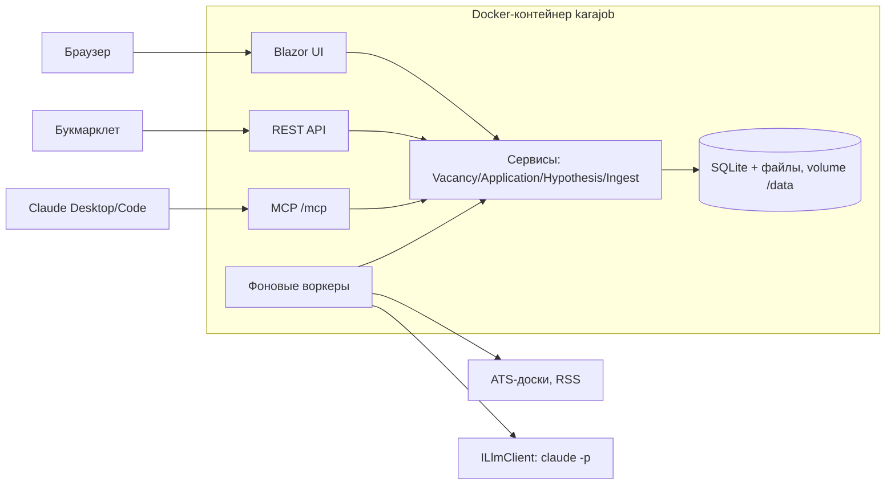

# Karajob — концепт и дизайн-документ

Nov 12, 2026 · @Maksim

## 1. Цель и принципы

Karajob — семейное (несколько профилей) веб-приложение в Docker, которое превращает поиск работы в управляемый эксперимент: гипотезы → вакансии → отклики → метрики → решение по гипотезе. Это прямая реализация шаблона карьерной стратегии: пункты 2 (гипотезы), 3 (каналы и учёт), 4 (критерии оценки) и 5 (решения) становятся сущностями и экранами.

**Принципы**

- **Данные ради решения.** Каждое поле должно кормить метрику или решение по гипотезе. Если поле ни на что не влияет — его нет в MVP.
- **Несколько профилей, один контейнер.** Без паролей и ролей, без микросервисов, без очередей. Сложность — только там, где её требует ИИ.
- **ИИ — опциональный слой.** Всё делается руками; ИИ лишь ускоряет ввод и поиск. Приложение не должно ломаться, если лимиты подписки кончились.
- **Приложение — источник правды, ИИ — клиент.** ИИ работает через тот же API/MCP, что и UI, и не хранит состояние.

### Что я поменял в исходных требованиях и почему

| Исходное требование | Проблема | Решение в концепте |
| --- | --- | --- |
| Канбан: Targeted, Preparing, Applied, Done | Нет стадии интервью — нельзя посчитать «конверсию в следующий позитивный шаг». «Done» смешивает оффер, отказ и тишину. | Inbox — отдельный раздел в боковом меню (входящие, ещё не разобранные), доска: Targeted → Preparing → Applied → Interviewing → Closed; у Closed обязательный исход (Offer / Rejected / Ghosted / Withdrawn). |
| У вакансии список гипотез | Конверсия по гипотезе требует однозначной атрибуции. Если отклик относится к двум гипотезам, метрика размазывается. | Вакансия может *подходить* нескольким гипотезам, но *отклик* привязан ровно к одной гипотезе и одному CV (снимок версии). |
| Критерий «≥10 релевантных вакансий в неделю» | Если считать только карточки на доске, метрика зависит от вашей лени, а не от рынка. | Отдельно учитываются *найденные* вакансии (Inbox, в т.ч. отклонённые — стадия Dismissed), а не только те, на которые вы откликнулись. |
| Решение «продолжать при конверсии 3–5%» | При 20 откликах одно интервью = 5%, ноль = 0%. Это шум, а не сигнал. | Минимальная выборка перед решением (по умолчанию 30 откликов или 3 недели) и показ доверительного интервала. |
| ИИ ходит по сайтам с вакансиями | Скрейпинг LinkedIn/Indeed нарушает их ToS, ломается от антиботов, а LLM-чтение HTML дорого. | Основной источник — публичные API ATS (Greenhouse, Lever, Ashby и т.п.) компаний из справочника, плюс RSS/API агрегаторов. ИИ только оценивает соответствие, а не скрейпит. |
| Справочник CV | Нужен, но без версий нельзя сказать, какой текст CV реально ушёл работодателю. | CV = документ с версиями; отклик ссылается на конкретную версию. |

## 2. Доменная модель

Центр модели — **отклик (Application)**, а не вакансия: именно он связывает вакансию, гипотезу и версию CV и даёт данные для конверсии. На практике карточка на доске = вакансия + её единственный отклик (1:0..1), так что для UI это одна сущность, а в БД — две. В коде отклик называется `JobApplication`: имя `Application` конфликтует с проектом `Karajob.Application`.

| Сущность | Ключевые поля | Связи |
| --- | --- | --- |
| **SearchGoal** (Цель поиска, singleton) | роль, отрасли, формат (релокация/удалёнка/гибрид), желаемый доход gross + валюта, страны, must-have условия, дедлайн поиска, недельные цели (отклики / контакты / адаптации) | — |
| **Hypothesis** (Гипотеза) | название, роль, локации, индустрии, формат, ключевые слова для поиска / стоп-слова, позиционирование, сильные навыки, шаблон cover letter, заметка по LinkedIn, статус (Draft / Active / Expanded / Paused / Disabled), дата старта теста | N:1 CvDocument (основной CV), N:M JobSource, 1:N HypothesisCheckIn, 1:N HypothesisDecision |
| **CvDocument** (CV) | название, язык, теги | 1:N CvVersion; один CV — во многих гипотезах |
| **CvVersion** | исходник в Markdown, сгенерированный PDF (или загруженный файл + извлечённый текст), родительская версия, вакансия (для адаптированных), комментарий изменений, дата | N:1 CvDocument |
| **Company** (Компания) | название, **slug-ID (ubisoft), домены и алиасы (уникальны, для сопоставления)**, вебсайт, описание, иконка, страна/офисы, размер, ATS-тип + board token, личные заметки и «чёрный список» — в отдельной таблице UserCompanyNote, у каждого свои | 1:N Project, 1:N Vacancy |
| **Project** (Проект компании) | название, жанр/тип, движок, статус (анонс / в разработке / выпущен), ссылка | N:1 Company |
| **Vacancy** (Вакансия) | роль, ссылка (нормализованная, для дедупликации), локация, формат, вилка ЗП, сырой текст описания, требования (список), источник (manual / ai-link / ai-scan), дата публикации, дата обнаружения, стадия (Inbox, колонки доски или Dismissed), причина отклонения | N:1 Company, N:M Hypothesis через **VacancyMatch** (score 0–100, обоснование, кто поставил: человек/ИИ), 0..1 Application |
| **JobApplication** (Отклик) | дата отклика, канал (сайт / реферал / рекрутер / холодное письмо), cover letter (текст), исход (Offer / Rejected / Ghosted / Withdrawn) | N:1 Vacancy, **N:1 Hypothesis (ровно одна)**, **N:1 CvVersion** |
| **ApplicationEvent** | тип (StageChanged, Screening, TechInterview, TestTask, Rejected, Offer…), дата, заметка; для встреч — время начала/конца, часовой пояс, ссылка на звонок, ID события в Google Calendar | N:1 Vacancy: переходы стадий пишутся и до отклика (Inbox → Targeted → Preparing). Источник для всех метрик и таймлайна карточки. |
| **HypothesisCheckIn** | неделя, мотивация 1–5, уверенность 1–5, заметка | N:1 Hypothesis |
| **HypothesisDecision** | дата, решение (Continue / Expand / Disable), причина, снимок метрик на момент решения, что изменили (для Expand) | N:1 Hypothesis |
| **JobSource** (Площадка) | название, тип (AtsBoard / Rss / Api / ManualOnly), URL/параметры, частота опроса, включена, последний скан | N:M Hypothesis |
| **AiJob** | тип (ParseLink / ScanSource / Score), вход, статус, результат/ошибка, потраченные токены | Журнал фоновой ИИ-работы |

### Пользователи и мастер-профиль

Система семейная: несколько пользователей, без паролей и ролей. `UserId` закладывается с первой миграции, даже если пока вы один: сейчас это одно поле, а добавлять потом — переписывать все запросы.

| Сущность | Ключевые поля | Связи |
| --- | --- | --- |
| **User** (Профиль) | имя, аватар/цвет, язык интерфейса, токен для REST/MCP, свой токен Claude для фоновых задач (необязательно), банк ответов для форм | 1:1 MasterProfile, 1:1 SearchGoal, 1:N гипотез, CV, вакансий, откликов |
| **MasterProfile** (Мастер-профиль) | Один Markdown-документ с фиксированными разделами: контакты, опыт (все места работы и обязанности), проекты, достижения с цифрами, навыки, образование, языки, истории для интервью (STAR). История версий. | 1:1 User. Источник правды для генерации и адаптации CV, cover letter и подготовки к интервью |

Мастер-профиль — это всё, что правда про человека, без ограничения длины. CV — выборка из него под гипотезу на 1–2 страницы. Проверка на выдумки сверяет CV именно с ним. Первое заполнение: загрузить текущие CV и LinkedIn-экспорт, ИИ собирает черновик, дальше вы дописываете.

**Что личное, что общее.** Личное (фильтр EF Core по текущему `UserId`): цель поиска, мастер-профиль, гипотезы, CV, вакансии и отклики, чек-ины, решения, метрики, а также личные заметки и «чёрный список» по компаниям. Общее для семьи: справочники компаний, проектов и площадок — нет смысла заводить Ubisoft дважды. Сканер обходит площадку один раз, а фильтрует и скорит по гипотезам каждого пользователя.

**Вход.** Экран выбора профиля (как в Netflix) → cookie; переключатель — в шапке. REST и MCP определяют пользователя по персональному токену (`/mcp?u=<token>` или заголовок), иначе букмарклет и Claude не знают, чей это Inbox. Токен здесь — не защита, а адрес. Без паролей приложение допустимо только в домашней сети (в т.ч. через WireGuard на роутере), никогда — публично.

**Дедупликация.** У компании человекочитаемый ID (slug: ubisoft, blizzard), но ИИ сопоставляет её по домену сайта и алиасам, а не по названию: «Ubisoft», «Ubisoft Entertainment» и «Ubisoft Belgrade» иначе станут тремя записями. Slug задаёте вы (или ИИ предлагает), а домен страхует от того, что ИИ заведёт «ubisoft-entertainment» рядом с уже существующим «ubisoft». Для дочерних студий — необязательное поле ParentCompany. Вакансия дедуплицируется по нормализованному URL (без utm и трекинга) и по паре «компания + роль + 30 дней» как мягкое предупреждение.

**Вне MVP:** контакты и нетворкинг (рекрутеры, рефералы). Шаблон стратегии требует план нетворкинга, и рефералы конвертятся лучше холодных откликов — поэтому сущность **Contact** (имя, компания, LinkedIn, статус контакта) — первое, что стоит добавить в v2. Канал отклика уже есть в MVP, чтобы сравнивать конверсию рефералов и сайтов.

## 3. Канбан, жизненный цикл и окно отклика

Inbox — не колонка доски, а отдельный раздел в боковом меню (как бэклог): список неразобранных карточек. Доска — пять колонок, Targeted → Closed. Каждое перемещение, включая выход из Inbox, пишет ApplicationEvent, поэтому метрики считаются из истории, а не из текущего состояния.

| Стадия | Что значит | Вход | Выход |
| --- | --- | --- | --- |
| **Inbox** (раздел в меню) | Найдено, но не разобрано. Сюда падает всё от ИИ. | ИИ-скан, ссылка, ручной ввод | Кнопки на карточке: «→ На доску» (в Targeted, сразу отметить подходящие гипотезы) или «Отклонить» с причиной (не та роль / локация / стек / ЗП) → стадия Dismissed |
| **Targeted** | Хочу откликнуться. Выбрана гипотеза. | Из Inbox или сразу | В Preparing |
| **Preparing** | Адаптирую CV, пишу cover letter, ищу реферала. | — | В Applied через окно отклика |
| **Applied** | Отклик отправлен. Зафиксированы гипотеза, версия CV, канал, дата. | — | Interviewing или Closed. Через N дней (по умолчанию 21) без ответа — подсказка «Ghosted?» |
| **Interviewing** | Любой позитивный следующий шаг: скрининг, тестовое, интервью. Внутри — таймлайн этапов. | Из Applied | Closed |
| **Closed** | Закрыто с обязательным исходом: Offer / Rejected / Ghosted / Withdrawn. По умолчанию скрыта, счётчики в заголовке. | Из любой колонки доски | — |
| **Dismissed** (не на доске) | Отклонено при разборе Inbox, с причиной. Не отклик, поэтому не попадает в Closed и в конверсию, но считается в метрике «Рынок». | Из Inbox | — |

Фильтры доски: гипотеза, компания, источник. Золотое правило: без выбранной гипотезы карточку нельзя перевести в Applied, иначе отклик выпадет из аналитики.

### Быстрое добавление в Inbox (Quick Add)

Добавить вакансию можно в 1–2 клика с любого устройства. Ввод — только URL (плюс необязательная заметка); карточка создаётся сразу со статусом «разбирается», а парсинг и привязка к компании идут в фоне. Если ИИ недоступен, карточка просто ждёт в Inbox со ссылкой — ничего не теряется.

| Где вы | Как добавить |
| --- | --- |
| В приложении, любой экран | Кнопка «+ Вакансия» в шапке (на телефоне — плавающая кнопка) → поле URL, вставка из буфера → Enter |
| Телефон Android | Приложение устанавливается как PWA и появляется в меню «Поделиться» (Web Share Target): из браузера или приложения LinkedIn — «Поделиться → Karajob» |
| Телефон iPhone | У PWA на iOS нет пункта в «Поделиться», поэтому — быстрая команда (Shortcuts), которая шлёт URL в REST `POST /api/inbox` |
| Десктопный браузер | Букмарклет «В трекер» (см. раздел 5): один клик, заодно забирает текст закрытых страниц |
| Чат с Claude | «добавь \<url>» → MCP `ingest_vacancy` |

Предусловие: доступ к приложению с телефона вне домашней сети — через уже настроенный WireGuard на роутере (см. «Доступ» в разделе 6), и адаптивная вёрстка хотя бы у Inbox и Quick Add. Подводный камень: PWA (установка на телефон и пункт в «Поделиться») работает только по HTTPS, а по http://192.168.x.x браузер её не установит. Нужен реверс-прокси с сертификатом: либо свой домен + Let's Encrypt через DNS-проверку (порты наружу открывать не нужно), либо локальный сертификат Caddy, добавленный в доверенные на телефонах. Без HTTPS остаётся кнопка «+ Вакансия» в обычном браузере и закладка на рабочем столе — тоже 2 клика. Это входит в Фазу 0, а не в поздние фазы.

### Единое окно отклика (Apply Panel)

Полностью универсальная отправка «одной кнопкой» недостижима и вредна. Публичные API Greenhouse/Lever дают читать вакансии, а отправка отклика через них требует ключа самой компании. Формы Workday, LinkedIn Easy Apply и сайтов студий разные, часто с CAPTCHA и запретом ботов в ToS. Кроме того, автоотклики толкают к количеству вместо качества — а ваша же стратегия строится на адаптации под гипотезу.

Поэтому окно отклика — это **единая точка подготовки и фиксации**, а не единый способ отправки:

1. **Пакет.** Выбор гипотезы → подставляется её CV (можно сменить версию) и шаблон cover letter. Кнопка «Сгенерировать письмо» — ИИ пишет черновик по вакансии + позиционированию гипотезы, вы правите.
2. **Банк ответов.** Сохранённые ответы на типовые вопросы форм (ожидания по ЗП, нотис, виза/разрешение на работу, линки на GitHub/портфолио, «Why us»). Каждое поле — с кнопкой «копировать».
3. **Отправка по каналу:**
   - *Email* (в вакансии указан адрес) — приложение письма не отправляет. Кнопки копируют адрес, тему и текст, CV скачивается файлом, а письмо вы отправляете из своей почты сами.
   - *Форма на сайте* — кнопка открывает ссылку в новой вкладке, CV скачивается с правильным именем файла, поля вставляются из банка ответов. В v3 — ассистированное заполнение формы агентом в браузере (Claude с браузером или Playwright) с остановкой перед «Submit» — нажимаете вы.
   - *Реферал / рекрутер* — текст сообщения для LinkedIn/Telegram с кнопкой копирования.
4. **«Откликнулся».** Одна кнопка фиксирует Application (гипотеза, версия CV, текст письма, канал, дата) и переносит карточку в Applied.

### Адаптация и генерация CV

Кнопок две, и живут они в разных местах, потому что решают разные задачи:

- **«Адаптировать CV под вакансию» — в окне отклика**, рядом с выбором CV (шаг 1 «Пакет»). ИИ берёт CV гипотезы и текст вакансии, переставляет акценты (summary, порядок пунктов, ключевые слова для ATS) и создаёт дочернюю версию, привязанную к вакансии. Вы видите diff относительно исходника, правите и подтверждаете — PDF собирается сразу.
- **«Новый CV для гипотезы» — в справочнике CV и на карточке гипотезы.** ИИ собирает черновик из мастер-профиля (полный список опыта, проектов и достижений) под роль и позиционирование гипотезы. Это редкая операция — раз на гипотезу.

Два требования, без которых это не заработает:

- **Исходник CV — текст, а не PDF.** ИИ не может аккуратно править готовый PDF. Поэтому CV хранится в Markdown и рендерится в PDF по шаблону (QuestPDF или HTML → PDF через Playwright). Загруженные PDF остаются как «ручные» версии без адаптации. Перенос вашего текущего CV в Markdown — одноразовая работа.
- **Защита от выдумок.** Адаптация может переформулировать и переставлять, но не добавлять навыки, цифры и проекты, которых нет в мастер-профиле. После генерации код подсвечивает числа и технологии, которых нет в исходнике. Выдуманный пункт в CV всплывёт на интервью.

Для метрик адаптированные версии считаются по их родительскому CV — иначе каждый отклик окажется со «своим CV» и сравнивать станет нечего. Адаптация — Фаза 1 (через скил `karajob-apply`), кнопка в UI — Фаза 2.

Для сайтов это забирает большую часть рутины без хрупких интеграций: вы не ищете файлы и тексты, а фиксация для метрик не зависит от дисциплины.

## 4. Метрики и решения по гипотезам

У каждой гипотезы есть карточка-дашборд с тремя критериями из шаблона и подсказкой по решению. Решение принимаете вы; приложение лишь не даёт принять его на слишком малой выборке без предупреждения.

| Критерий | Как считается | Порог (настраиваемый) |
| --- | --- | --- |
| Рынок | Вакансии с VacancyMatch ≥ порога релевантности, найденные за неделю (по дате обнаружения, включая отклонённые из Inbox) | < 10/нед → «слишком узкая» |
| Конверсия | Отклики с хотя бы одним позитивным событием (скрининг, тестовое, интервью) / все отклики гипотезы. Отклики младше 14 дней не считаются — им ещё рано отвечать. | ≥ 3–5% → продолжать |
| Самочувствие | Среднее мотивации и уверенности из еженедельных чек-инов (1–5) + тренд | ≤ 2 две недели подряд → сигнал «не подходит лично» |
| Активность | Отклики, контакты и адаптации CV за неделю против целей из SearchGoal | пункт 3 шаблона |

### Честность конверсии

Порог 3–5% на малых числах почти ничего не доказывает. Одно интервью из 30 откликов — это 3,3%, но 95%-й интервал Уилсона — от 0,6% до 16,7%. Ноль из 30 при реальной конверсии 5% случается с вероятностью около 21% (0,95^30), ноль из 50 — около 8%. Отсюда три правила для UI:

- Рядом с процентом всегда показывать «k из n» и интервал.
- До минимальной выборки (по умолчанию 30 созревших откликов) статус — «данных мало», а не «не работает».
- Быстрее всего сигнал дают критерии «рынок» и «самочувствие» — их стоит проверять с первой недели, а конверсию оценивать не раньше 3–4 недели.

### Дерево решений

1. Мало данных → продолжать без решения.
2. Рынок < 10/нед → **Expand**: расширить индустрии/локации/формат без смены CV. В решении фиксируется, что именно расширено, и начинается новый период метрик, чтобы не смешивать «до» и «после».
3. Конверсия ≥ 3–5% → **Continue**.
4. Конверсия ниже порога при нормальном рынке → сначала сменить CV/позиционирование (это новая версия гипотезы), повторная неудача → **Disable**. Этого шага нет в шаблоне, но без него вы выбросите рабочее направление из-за плохого резюме.
5. Самочувствие стабильно низкое → **Disable** с причиной «не подходит лично», независимо от цифр.

При отключении приложение предлагает активировать следующую гипотезу из Draft и предупреждает, если активных гипотез больше 3 или меньше 2 (правило шаблона).

**Еженедельный обзор (Weekly Review)** — один экран: метрики по всем активным гипотезам, чек-ин самочувствия, зависшие отклики (Ghosted?), факт против недельных целей и кнопки решений. Это главный ритуал, вокруг которого строится инструмент.

## 5. ИИ-интеграция

Вашу подписку Claude Pro можно использовать двумя способами, и стоит взять оба: **MCP** — для интерактивной работы из чата, **`claude -p` (Claude Code CLI)** — для фоновой автоматизации. Прямого доступа к API подписка не даёт; API-ключ — отдельная потокенная оплата.

| Вариант | Как работает | Чем платите | Для чего |
| --- | --- | --- | --- |
| **A. MCP-сервер в приложении** | Claude (Desktop / Code / claude.ai) — клиент. Вы пишете «добавь вакансию \<url>», Claude сам читает страницу и вызывает инструменты `upsert_company`, `create_vacancy`. | Обычные лимиты подписки | MVP. Ни строки LLM-кода в бэкенде. Разовые задачи: разобрать ссылку, написать cover letter, провести weekly review. |
| **B. `claude -p` в контейнере-воркере** | Бэкенд запускает CLI в неинтерактивном режиме с `--output-format json` и токеном из `claude setup-token` (переменная `CLAUDE_CODE_OAUTH_TOKEN`). | Лимиты подписки | Фон: парсинг ссылок из UI, скоринг вакансий от сканера. |

**Риск варианта B.** Правила Anthropic по программному использованию подписки менялись в 2026 году минимум три раза ([The Register](https://www.theregister.com/2026/02/20/anthropic_clarifies_ban_third_party_claude_access), [The Register, май](https://www.theregister.com/ai-ml/2026/05/14/anthropic-tosses-agents-into-the-api-billing-pool/5240748)). Сейчас справка Anthropic говорит, что при входе с подпиской Agent SDK и `claude -p` расходуют лимиты подписки ([Help Center](https://support.claude.com/en/articles/15036540-use-the-claude-agent-sdk-with-your-claude-plan)). Подписка личная, и лимиты рассчитаны на индивидуальное использование. Поэтому в семейном режиме фоновые задачи каждого профиля идут на его собственном токене Claude, а профиль без токена работает в ручном режиме и через MCP из своего Claude. Вывод: все вызовы — через интерфейс `ILlmClient` (пока одна реализация — B; если правила изменятся, провайдер меняется в одном месте), дневной лимит вызовов. И перед реализацией перепроверить актуальные условия.

### Сценарий 1: ссылка → карточка

1. **Получить текст.** Если URL — известный ATS (Greenhouse, Lever, Ashby, Workable, SmartRecruiters), берём JSON из их публичного API — структура без LLM. Иначе — HttpClient + извлечение читаемого текста (SmartReader / AngleSharp).
2. **Если страница закрыта** (LinkedIn требует логин, часть сайтов рендерится JS) — **букмарклет «В трекер»**: нажимаете его на открытой вакансии, он отправляет URL и текст страницы из вашего браузера, где вы уже залогинены. Это надёжнее любого серверного скрейпинга. Последний резерв — вставить текст руками.
3. **Извлечь поля.** LLM с JSON-схемой: компания, домен, роль, сеньорность, локация, формат, вилка, требования, email для отклика (если есть).
4. **Компания.** Поиск по домену; если нет — создать с иконкой (favicon домена) и пометкой «не проверено». Описание и проекты — отдельной задачей обогащения с сайта компании.
5. **Матчинг.** Оценка соответствия активным гипотезам → VacancyMatch с обоснованием.
6. **В Inbox** с бейджем «AI». Вы проверяете и переносите в Targeted. ИИ никогда не кладёт карточки сразу в рабочие колонки.

### Сценарий 2: автопоиск по гипотезам

Обход «сайтов с вакансиями» агентом — дорого, медленно и хрупко. Вместо этого — **конвейер, где LLM вызывается только на последнем шаге**:

1. **Сбор** (без ИИ, по расписанию). Источники по приоритету: (а) ATS-доски компаний из справочника — вы один раз добавляете студию, и все её новые вакансии приходят сами; (б) RSS/API агрегаторов, которые их отдают (для русскоязычных гипотез — API hh.ru, его текущие условия доступа нужно проверить; геймдев-каналы в Telegram — через пересылку боту или Quick Add); (в) LinkedIn и подобные — только через букмарклет или email-алерты, без скрейпинга.
2. **Дедупликация** по нормализованному URL и внешнему ID.
3. **Дешёвый предфильтр** по полям гипотезы: ключевые слова в заголовке, стоп-слова (Senior Manager, QA, Artist…), локация/формат. Отсекает подавляющую часть мусора бесплатно.
4. **LLM-скоринг** выживших: вход — вакансия + описание гипотезы + текст её CV, выход — score, короткое обоснование, красные флаги (нужен паспорт ЕС, только on-site и т.п.).
5. **Результат.** Score ≥ порога → Inbox. Все прошедшие предфильтр считаются в метрике «Рынок» — это и есть честный ответ на «10 вакансий в неделю».

**Переиспользуем [career-ops](https://github.com/career-ops-hq/career-ops) (MIT).** Сканер и оценку вакансий с нуля не пишем, берём из него в два шага:

1. **Данные и промпты (дёшево, надёжно).** Импорт `portals.yml` (компании + их ATS) как стартового наполнения справочника компаний. Их режимы оценки и CV — основа для наших скилов `karajob-ingest` и `karajob-apply`, адаптированные под гипотезы.
2. **Сканер как сайдкар (если шага 1 мало).** Отдельный Node-контейнер с career-ops по расписанию запускает `npm run scan` на общем volume. Наш импортер забирает новое из `data/pipeline.md` в Inbox, а дальше идут наши предфильтр и скоринг по гипотезам.

Риски: формат `pipeline.md` не документирован как контракт — фиксируем версию career-ops и покрываем парсер тестом. Провайдеры там в основном про международный рынок, так что для русскоязычных гипотез hh.ru и Telegram остаются на нас. Автозаполнение форм из Фазы 3 тоже можно взять из их режима `apply` (Playwright, остановка перед Submit).

Самая ценная автоматизация для геймдева — пункт (а). Рынок студий конечен: список из 100–200 интересных компаний с их ATS-досками даст полноту без агрегаторов, а справочник компаний перестаёт быть просто справочником.

### Другие места для ИИ

- Черновик cover letter в окне отклика.
- Gap-анализ «вакансия vs CV»: чего не хватает, что подчеркнуть.
- Анализ отказов по гипотезе: общие требования у вакансий, где вас не позвали.
- Подготовка к интервью по карточке в Interviewing: проекты компании + требования → вероятные вопросы.

## 6. Архитектура и стек

Один ASP.NET Core-процесс отдаёт UI, REST API и MCP-эндпоинт, а все три вызывают один и тот же слой прикладных сервисов. Без этого правила бизнес-логика (дедупликация, запрет Applied без гипотезы) разъедется между UI и ИИ-инструментами.

ИИ входит дважды: снаружи — как клиент MCP, изнутри — через фоновые воркеры; и тот, и другой пишут данные только через сервисы.

| Слой | Выбор | Почему / альтернатива |
| --- | --- | --- |
| Рантайм | .NET 10 (LTS), ASP.NET Core | Текущая LTS-версия. |
| Фронтенд | **Blazor (Interactive Server) + MudBlazor** | Весь UI на C#, без npm и сборки JS. В MudBlazor есть drag-and-drop (`MudDropContainer`) — канбан собирается из готовых компонентов. Минус Server-режима (постоянное SignalR-соединение) для одного пользователя не важен. Альтернатива: Razor Pages + htmx + SortableJS — проще в дебаге, но всё равно немного JS. |
| БД | **SQLite + EF Core** | Несколько членов семьи, тысячи записей. Один файл на volume, бэкап = копирование. PostgreSQL — лишний контейнер без выигрыша; Смена СУБД — настройкой, см. «Независимость от СУБД» ниже. |
| Файлы | CV и иконки на volume `/data/files`, путь в БД | Текст CV извлекается при загрузке (PdfPig для PDF, OpenXML для DOCX) и хранится для ИИ. |
| Фоновые задачи | `BackgroundService` + таблица AiJob как очередь | Для MVP достаточно. Hangfire/Quartz — если понадобятся сложные расписания и дашборд ретраев. |
| MCP | Официальный C# SDK (`ModelContextProtocol.AspNetCore`), Streamable HTTP на `/mcp` | В том же процессе, что и UI. Инструменты — тонкие обёртки над прикладными сервисами. |
| LLM | `ILlmClient`: ClaudeCli | См. раздел 5. Все вызовы — с JSON-схемой ответа и валидацией. |
| Доступ | Выбор профиля без пароля (cookie) + персональный токен для REST/MCP | Наружу не выставлять; удалённый доступ — через WireGuard-VPN на домашнем роутере. В БД лежат CV и персональные данные. |

### Независимость от СУБД

СУБД выбирается параметром `Database:Provider` (`Sqlite` | `Postgres`) без изменения кода. EF Core уже и есть абстракция над СУБД; свой слой репозиториев поверх него не добавит переносимости, только код. Ломается переносимость на деталях, поэтому правила такие:

- **Миграции — отдельный проект на каждого провайдера** (`Karajob.Migrations.Sqlite`, `Karajob.Migrations.Postgres`). Миграции EF Core привязаны к провайдеру, один набор на оба не работает. Каждое изменение модели — две миграции, одним скриптом.
- **Только то, что умеют оба провайдера.** Никакого сырого SQL и специфичных функций в запросах. Время хранится как UTC `DateTime`, а не `DateTimeOffset`: SQLite-провайдер EF Core не сортирует и не сравнивает его на стороне БД. Деньги (вилки ЗП) — целые числа в минимальных единицах вместо `decimal`, с которым у SQLite те же ограничения.
- **Нормализация в приложении, а не в БД.** Slug, домены, алиасы и URL приводятся к нижнему регистру до записи. Иначе уникальные индексы и поиск ведут себя по-разному: у СУБД разные правила сравнения строк.
- **Тесты на обеих СУБД.** Интеграционные тесты сервисов гоняются на SQLite и на PostgreSQL (Testcontainers). Без этого вторая СУБД тихо сломается через пару месяцев.
- **Перенос данных.** Команда экспорта/импорта всей базы в JSON (через тот же EF Core): смена СУБД = экспорт → смена параметра → импорт. Заодно это человекочитаемый бэкап.

**Режим для отладки и тестов — SQLite in-memory, а не EF Core InMemory.** Провайдер InMemory не реляционный: в нём не срабатывают уникальные индексы, внешние ключи и транзакции, а Microsoft не рекомендует его для тестов. У нас часть логики держится на уникальности (slug, домены, URL вакансий), и с InMemory тесты будут зелёными ровно там, где прод падает. Вместо этого — третье значение `Database:Provider=SqliteInMemory`: тот же SQLite с теми же миграциями, база живёт в памяти, пока открыто соединение, и при старте заполняется сид-данными (пара профилей, гипотезы, десяток карточек в разных колонках). Для юнит-тестов `Karajob.Domain` БД не нужна вообще.

### Миграции схемы

Схема меняется только миграциями EF Core, а применяются они автоматически при старте контейнера, с бэкапом перед каждым применением. Для одного экземпляра приложения это проще отдельного шага деплоя.

1. **Создание.** Скрипт `scripts/add-migration <Name>` вызывает `dotnet ef migrations add` для каждого провайдера (сейчас — только SQLite). Одна команда, чтобы наборы не разъехались. Миграции коммитятся и ревьюятся как код.
2. **Проверка тестом.** Обычный xUnit-тест (запускается локально: \`dotnet test\` перед сборкой образа, можно прямо в скрипте сборки; тот же dotnet test запускается в GitHub Actions на каждый push — один YAML-файл в .github/workflows) падает, если модель изменена, а миграция не создана (pending model changes), и прогоняет все миграции на пустой БД и на копии базы предыдущей версии.
3. **Применение.** На старте, до приёма запросов: если есть неприменённые миграции, сначала делается копия базы в `/data/backups/<дата>-before-<миграция>.db`, потом `Database.MigrateAsync()`. Если миграция упала, приложение не стартует, а в логе есть путь к бэкапу. `EnsureCreated()` не используется нигде: он несовместим с миграциями.
4. **Откат = восстановление бэкапа + предыдущий образ.** Down-миграции не поддерживаем: для SQLite EF Core пересобирает таблицы, и дауны часто теряют данные. Будут давать ложное чувство безопасности.
5. **Миграции данных** (например, заполнить `UserId` у старых записей) — не сырым SQL внутри миграции, а C#-классами `IDataPatch` с номером. Они выполняются после схемных миграций один раз, учёт ведётся в таблице `__DataPatches`. Так они работают на любой СУБД и покрываются тестами.

Цена: двойные миграции и дольше прогон тестов. До реальной нужды в PostgreSQL можно соблюдать правила 2–3 и экспорт/импорт, а второй набор миграций с тестами добавить в день переезда.

**Решение про Docker.** Один образ `karajob` (ASP.NET + установленный Claude Code CLI для варианта B) и один volume `/data` (SQLite + файлы). `docker compose up` — и всё. Секреты (`CLAUDE_CODE_OAUTH_TOKEN`) — через `.env`, не в образе и не в гите.

**Структура решения:**

- `Karajob.Domain` — сущности, правила переходов стадий, расчёт метрик (чистый C#, покрыт юнит-тестами).
- `Karajob.Application` — сервисы сценариев: `VacancyService`, `ApplicationService`, `HypothesisService`, `IngestService`.
- `Karajob.Infrastructure` — EF Core, клиенты ATS, извлечение текста, LLM-клиенты.
- `Karajob.Web` — Blazor-страницы, Minimal API, MCP-инструменты, фоновые воркеры.

Экраны MVP: Доска · Карточка вакансии + окно отклика · Гипотезы (список + дашборд) · Компании · CV · Площадки · Weekly Review · Настройки (цель поиска, пороги, ИИ-провайдер, банк ответов).

## 7. API, MCP-инструменты и скилы

MCP-инструменты проектируются под сценарии, а не как зеркало CRUD: чем меньше инструментов и чем больше логики в них, тем реже модель ошибается и тем меньше тратится лимитов на промежуточные вызовы. REST API покрывает то же самое для букмарклета и скриптов, OpenAPI — из коробки.

| MCP-инструмент | Что делает |
| --- | --- |
| `get_search_context` | Цель поиска + активные гипотезы (кратко) + список CV. Первый вызов любого сценария. |
| `ingest_vacancy` | Принимает URL и/или уже извлечённые поля. Сам делает дедупликацию, upsert компании по домену, создаёт карточку в Inbox. Возвращает ID и предупреждения («похожая вакансия уже есть»). |
| `search_vacancies` | Поиск по доске: стадия, гипотеза, компания, текст. |
| `get_vacancy` | Полная карточка: описание, матчи, отклик, таймлайн, компания с проектами. |
| `set_match` | Записать оценку соответствия вакансии гипотезе (score + обоснование). |
| `move_vacancy` | Перевод по стадиям с теми же правилами, что в UI. ИИ не может перевести в Applied — это только через окно отклика. |
| `add_event` | Добавить событие к отклику («пришло приглашение на скрининг»). |
| `save_cover_letter_draft` | Сохранить черновик письма в карточку. |
| `upsert_company` / `add_company_project` | Обогащение справочника компаний. |
| `get_hypothesis_report` | Метрики гипотезы за период + подсказка по дереву решений. |
| `record_checkin` / `record_decision` | Чек-ин самочувствия и решение по гипотезе — только с вашими словами, ИИ не решает за вас. |
| `get_cv_text` | Текст конкретной версии CV для gap-анализа и писем. |

**Подключение.** Для Claude Code — `claude mcp add --transport http karajob http://localhost:8080/mcp` с заголовком авторизации. Для Claude Desktop — локальный конфиг. Custom connector в веб-версии и мобильном приложении Claude требует публичного HTTPS-адреса (например, Cloudflare Tunnel) и полноценной авторизации. Это удобно («добавить вакансию с телефона»), но выставляет базу с CV в интернет — переносим в v2 и делаем только с OAuth.

### Скилы

Инструменты дают ИИ *возможности*, скилы — *процедуру*. Хранятся в репозитории (`.claude/skills/*/SKILL.md`) для Claude Code, те же файлы загружаются в claude.ai. Воркер варианта B использует их же как промпты — одна истина для интерактива и фона.

| Скил | Сценарий |
| --- | --- |
| `karajob-ingest` | Ссылка → прочитать → извлечь поля → `ingest_vacancy` → оценить по активным гипотезам → `set_match`. Правила: не выдумывать вилку, домен — с сайта компании, а не джобборда. |
| `karajob-apply` | Gap-анализ + cover letter по позиционированию гипотезы и проектам компании, длина и тон из настроек. |
| `karajob-weekly-review` | Собрать отчёты по гипотезам, спросить мотивацию/уверенность, пройти дерево решений, записать чек-ин и решение после вашего подтверждения. |
| `karajob-company-research` | Изучить сайт студии → описание, проекты, ATS-доска → `upsert_company`. |
| `karajob-interview-prep` | По карточке в Interviewing: вероятные вопросы, истории из опыта под требования, вопросы к работодателю. |

## 8. Роадмап, риски

Главный риск проекта не технический: строительство инструмента легко подменяет сам поиск. Поэтому первая фаза должна быть готова к реальному использованию за 2–3 дня, а до тех пор отклики ведутся в таблице с теми же колонками (гипотеза, CV, канал, дата, исход) и потом импортируются. И ещё: для целевой роли UE5-разработчика этот проект почти не добавляет веса портфолио, так что его ценность — только в сэкономленном времени и лучших решениях.

Фазы и подробный план Фазы 0 по дням — в [roadmap.md](roadmap.md).

| Риск | Вероятность | Мера |
| --- | --- | --- |
| Проект затягивается и съедает время поиска | Высокая | Жёсткий скоуп Фазы 0; таблица до её готовности; ничего из Фазы 2, пока инструмент не используется ежедневно |
| Anthropic снова меняет правила `claude -p` на подписке | Средняя | `ILlmClient` + ручной режим: карточки ждут в Inbox, поля заполняются вручную; MCP-путь не затронут |
| ИИ ошибается при парсинге (выдуманная вилка, не та компания) | Средняя | Всё от ИИ — в Inbox с бейджем; JSON-схема; сырой текст вакансии сохраняется для проверки |
| Сайты блокируют сбор / бан аккаунта LinkedIn | Высокая при скрейпинге | Не скрейпить: ATS-API, RSS, букмарклет |
| Потеря данных | Низкая | Ежедневная копия `/data` (SQLite backup API) |

**Источники:** шаблон «Шаблон карьерной стратегии поиска на международке» (Obsidian); [Use the Claude Agent SDK with your Claude plan](https://support.claude.com/en/articles/15036540-use-the-claude-agent-sdk-with-your-claude-plan); [Claude Code: authentication](https://code.claude.com/docs/en/authentication); [The Register, 20.02.2026](https://www.theregister.com/2026/02/20/anthropic_clarifies_ban_third_party_claude_access); [The Register, 14.05.2026](https://www.theregister.com/ai-ml/2026/05/14/anthropic-tosses-agents-into-the-api-billing-pool/5240748).
